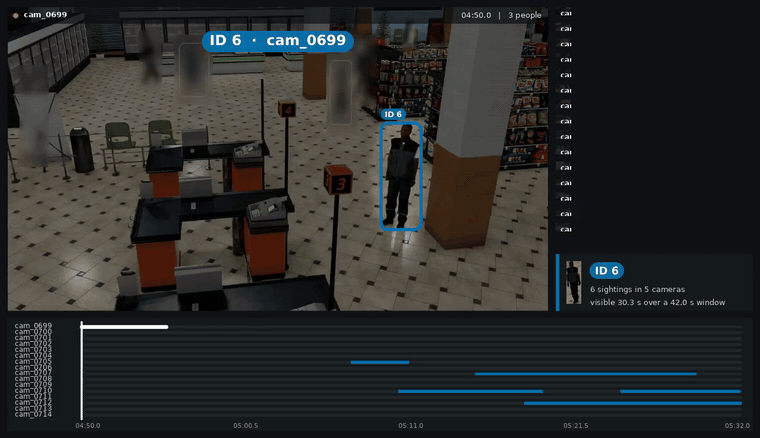
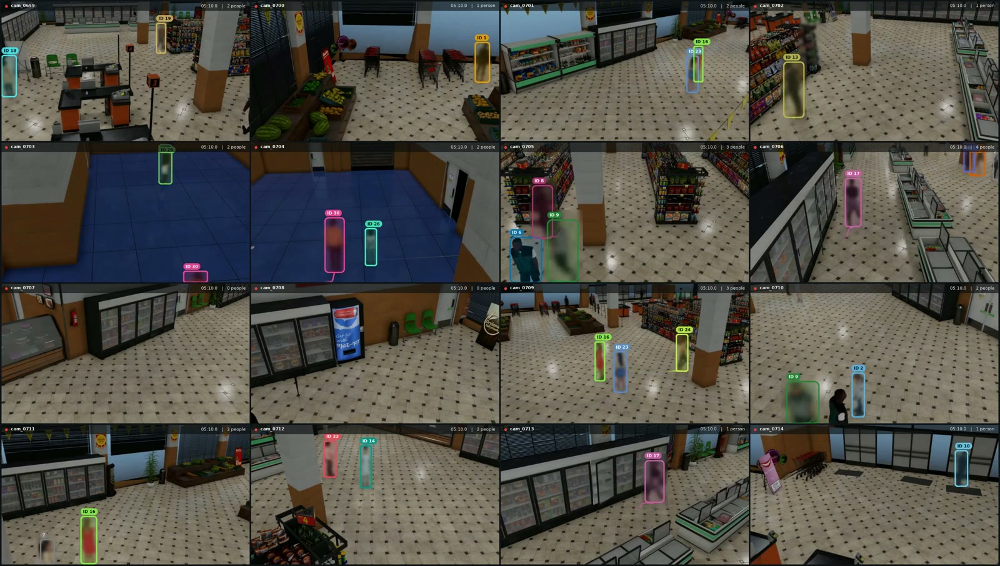
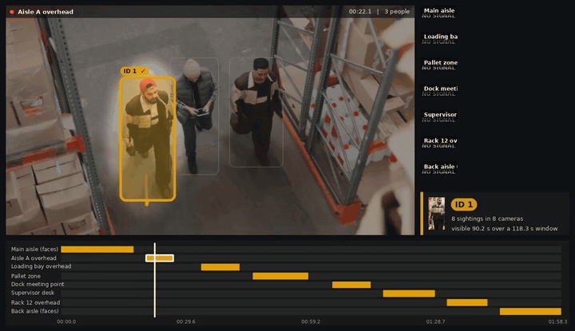
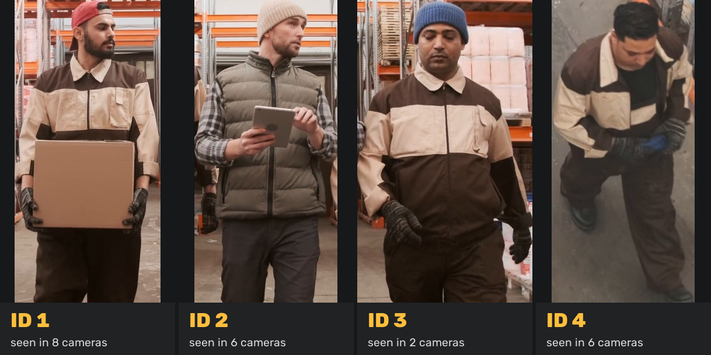
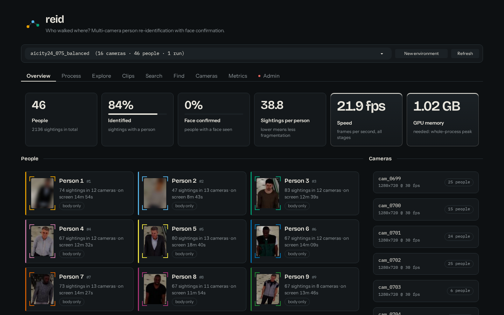
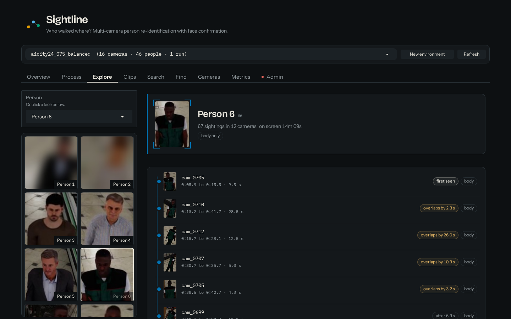
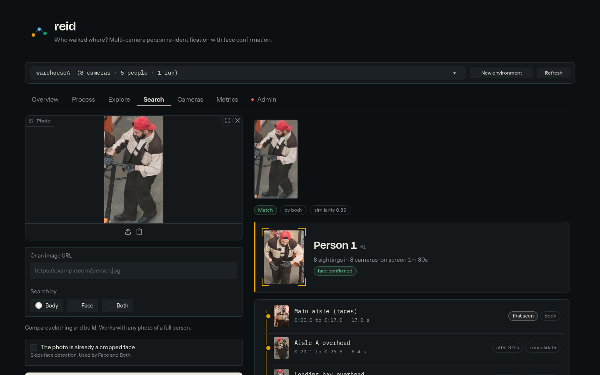
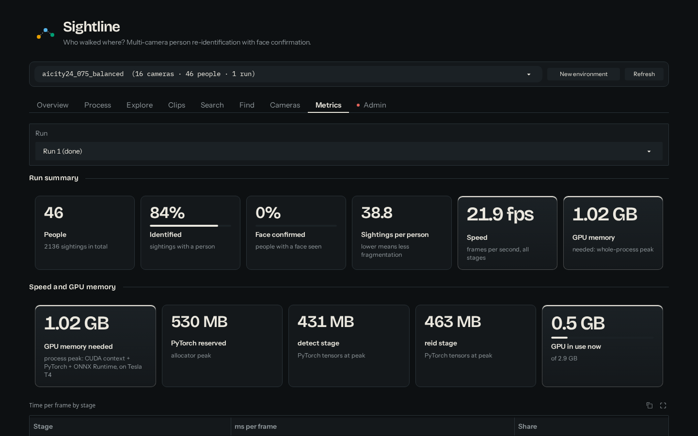

# Open-World Multimodal Multi-Camera Person Re-ID

*Body and face re-identification across cameras, for people it has never seen before.*

**A person re-identification pipeline you can deploy on any set of cameras.** Point it at the video feeds of a
shop, a warehouse or an office, with no training, no calibration and no list of known people. It detects and
tracks everyone in each camera, gives each person one identity across all cameras, and creates new identities
for people it has never seen before (open world). Body appearance links people across cameras, and when a face is
visible it confirms the identity. The result is a searchable record of who was where and when: search by photo,
follow one person from camera to camera, and measure dwell times. It runs on a free Colab GPU, a laptop graphics
card or even a CPU, keeps all data local, and ships as an installable Python package with a command line and a
web app.

<p align="center">
  <a href="assets/showcase/aicity_follow.mp4"></a>
</p>

*One shopper (ID 6) followed through four of the 16 cameras of an AI City Challenge store: the large view cuts to
whichever camera sees him, the timeline shows where he was seen. He keeps the same ID in every camera,
without any training on this data. Other people were blurred to focus on the man being followed,
but they are detected and tracked too (see the 16-camera view below).
[Full clip](assets/showcase/aicity_follow.mp4) · footage: NVIDIA AI City 2024, CC-BY-4.0.*

[](https://colab.research.google.com/github/AbderrahimZineddineEsi/open-world-multimodal-multicam-reid/blob/v2/notebooks/colab_demo.ipynb)

---

## What it does

1. **Detects and tracks** people in each camera (YOLO26 or RF-DETR, BoT-SORT / ByteTrack / OccluBoost).
2. **Builds tracklets**: one piece of one person's path in one camera, with quality-gated body samples
   (pose visibility, detection confidence, size, not cut by the frame edge) and the best faces. A tracklet is cut automatically if the
   tracker swapped two people who crossed.
3. **Decides identity once per tracklet** with a self-adaptive gallery (Casao et al., 2023): body appearance
   (CLIP-ReID), face evidence (ArcFace) used as the strongest signal, and constraints such as "one person cannot
   be in two places at the same time". Unknown people are clustered into new identities; fragments of one
   person are merged at the end of a run, reversibly.
4. **Answers questions**: search by photo (body, face or both), each person's journey and time line, dwell
   times, a follow-this-person video that cuts from camera to camera, and tracking metrics.

Everything is stored locally (SQLite + NumPy + image files) in self-contained *environments*, one per set of
cameras, so nothing needs a cloud account.

## Results

### Official AI City Challenge benchmark: 55.3 HOTA on unseen scenes, with no training on the data

The [AI City Challenge](https://www.aicitychallenge.org/) is NVIDIA's yearly computer-vision competition (CVPR
workshop). Its 2024 multi-camera people tracking track drew 421 registered teams. The test scenes are
photo-realistic synthetic indoor spaces such as shops and warehouses, built by NVIDIA: **16 calibrated cameras
watching the same space, 13 min 20 s of 1080p video each, 30 to 36 people walking around**, often out of one camera's view and into another's. The task is to say,
for every frame, where each person stands on the floor and *who* they are, with one ID per person across all 16
cameras. NVIDIA's official evaluator scores it with **HOTA**, which rewards finding people (DetA) and keeping
their identity over time and across cameras (AssA) equally.

This system ran the full scenes on one free Kaggle T4 GPU per scene, scored by NVIDIA's own evaluator:

| Scene | Seen before? | HOTA | Finding people (DetA) | Keeping identities (AssA) | Floor position (LocA) |
|---|---|---|---|---|---|
| 078 | **never** | **58.2** | 55.2 | 61.5 | 90.0 |
| 086 | **never** | **55.9** | 57.1 | 54.9 | 89.7 |
| 082 | **never** | **51.7** | 52.3 | 51.2 | 90.2 |
| **3 unseen scenes, mean** | | **55.3** | 54.9 | 55.9 | 90.0 |
| 075 | thresholds tuned on its first 2 minutes of 4 cameras (3.75% of it) | **67.5** | 67.2 | 67.7 | 90.9 |

**55.3 HOTA on scenes it had never seen falls between the 5th (57.1) and 6th (51.1) places of the
[2024 leaderboard](https://arxiv.org/abs/2404.09432)** (17 final submissions; their scores average all 30 test
scenes, these are 3 of them, so the placement is indicative). That was reached with:

- **No training on the benchmark.** Every model is used off the shelf. The leading entries fine-tuned their
  detectors and ReID models on AI City's own training scenes, the same synthetic people and the same kind of store.
- **Medium-sized models and under 1 GB of GPU memory.** A medium YOLO26 detector (it also gives the pose) and a
  ViT-B ReID model: 0.68 to 1.05 GB for the whole process, 0.46 GB of PyTorch memory for the two models that ran.
  The top teams used large detectors (ByteTrack's YOLOX, YOLOv8x) and separate pose models.
- **About 21 frames per second on one T4,** every second frame, for a whole 16-camera scene in about 2.4 hours.
- **Appearance only.** The top entries also matched people across cameras with the 3D calibration ("same spot on
  the floor at the same moment = same person"). Here the calibration only converts boxes to floor positions for
  the scorer, which is why LocA is about 90 on every scene. Using it for matching is the next step.

**One hand was tied behind its back: faces.** The AI City people are synthetic and have no usable faces, so the
face path, the strongest signal in this design, was off for the whole benchmark. In a real deployment, one or more
face cameras (an entrance, a till) let a face match link the fragments of a person across cameras as a hard
constraint, which targets exactly the main error measured here: one person split into several identities. That
effect has not been measured on this benchmark.

<p align="center">
  <a href="assets/showcase/aicity_mosaic.mp4"></a>
</p>

*All 16 cameras of scene 075 at once ([30 s video](assets/showcase/aicity_mosaic.mp4)), from the minute where
29 of its 30 people kept a single ID. Every box and ID label is the system's own output; people are blurred to
keep the focus on the tracking, except ID 6, the man followed in the clip at the top.*

Numbers, protocol and limits: [technical report §7](docs/technical_report.md). Reproduce with the
[Kaggle notebook](notebooks/kaggle_aicity_benchmark.ipynb) (below).

### Short benchmark slice and real footage

On the 2-minute, 4-camera slice of scene 075 used for tuning (10 people), the `balanced` preset gives
**10 identities for 10 people, none split or mixed**, cross-camera IDF1 88.3%, held-out search Rank-1 96%, at 34 fps
on a Colab T4. How the numbers are measured: [technical report](docs/technical_report.md).

<p align="center">
  
</p>

<p align="center">
  
</p>

*Eight clips of the same four warehouse workers, filmed from eight angles. The system gives each man one
identity: ID 1 is found in all 8 cameras and confirmed by his face; searching with a crop of each man
taken from one camera returns the right person (4 out of 4). Footage: Pexels, see [credits](assets/showcase/CREDITS.md).*

**Real footage** (the clips above, 8 cameras, 4 people): 4 identities with no person mixed into another,
3 of 4 men linked across every camera they appear in (the fourth is only visible in two cameras and gets one
identity there), search 4/4. Processed on a laptop-class GTX 1050 (3 GB) at 8.5 fps with the default `balanced` preset.

## The app

| | |
|---|---|
|  |  |
|  |  |

Tabs: **Overview** (people and cameras), **Process** (upload videos or paste video links), **Explore**
(a person's journey, time line and follow clip), **Search** (by body, face or both), **Cameras**,
**Metrics** (speed per stage, GPU memory, evaluation) and **Admin** (merge, split, rename, delete,
environments). Public links require a login.

## Run it

### On Colab (free GPU)

Open the [launcher notebook](https://colab.research.google.com/github/AbderrahimZineddineEsi/open-world-multimodal-multicam-reid/blob/v2/notebooks/colab_demo.ipynb),
choose a T4 runtime and run all cells. It installs the package, mounts Google Drive (your data persists
there) and prints a public link and a login for the app. Processing happens from the app.
[colab_walkthrough.ipynb](notebooks/colab_walkthrough.ipynb) reproduces the benchmark step by step.

### On your own computer

```bash
git clone -b v2 https://github.com/AbderrahimZineddineEsi/open-world-multimodal-multicam-reid.git
cd open-world-multimodal-multicam-reid
uv venv -p 3.12 && source .venv/bin/activate
uv pip install -e ".[models,app,eval]"     # GTX 10xx: install torch from the cu126 index first (pyproject.toml)
reid app --workspace data/environments      # opens the app at http://127.0.0.1:7860
```

The models are placed automatically: as much as fits goes on the GPU (detector first, then the body model),
the rest runs on the CPU, and an out-of-memory error moves a model to the CPU instead of stopping.
`--preset auto` (the default) picks the preset from the hardware:

| Preset | Models | GPU memory (measured) | Picked by `auto` when |
|---|---|---|---|
| `lite` | YOLO26n-pose, ByteTrack, OSNet, buffalo_sc | 0.26 GB | no GPU, or < 2 GB free |
| `balanced` | YOLO26m-pose, BoT-SORT, CLIP-ReID MSMT17, buffalo_l | 0.87 GB (1.0 GB on a T4 with faces on GPU) | a GPU with ≥ 2 GB free (incl. Colab T4) |
| `accurate` | RF-DETR-M + YOLO26s-pose, appearance-aware BoT-SORT, CLIP-ReID, buffalo_l | 0.82 GB | on request |
| `max` | RF-DETR-L + YOLO26m-pose, OccluBoost, CLIP-ReID, antelopev2 | 1.14 GB | on request |

Memory figures are whole-process peaks measured on a GTX 1050 (face models run on CPU on that card).

### Moving between Colab and your computer

Each environment is one folder, so it moves as a unit:

```bash
reid sync pull --workspace data/environments --remote <Drive folder or rclone remote>   # Colab -> PC
reid sync push --workspace data/environments --remote <...>                             # PC -> Colab
reid env export / reid env import                                                       # or as a zip
```

Sync refuses to overwrite an environment that changed on both sides (`--force` keeps a backup).
Details: [docs/local_app.md](docs/local_app.md).

### Reproduce the official benchmark (Kaggle, 2x T4)

[notebooks/kaggle_aicity_benchmark.ipynb](notebooks/kaggle_aicity_benchmark.ipynb) runs the `balanced` preset on four
full 16-camera test scenes of the AI City 2024 Track 1 dataset, scores them with NVIDIA's official HOTA evaluator and
saves databases, crops, 720p videos, predictions, scores and logs. Upload it to Kaggle, choose **GPU T4 x2** and
**Internet on**. Run it first with `SMOKE = True` (about 10 to 15 minutes: one scene, 2 cameras, 2 minutes; it
prints a projection of the full run), then set `SMOKE = False` and use *Save Version, Save & Run All (Commit)*.
A scene that fails is recorded and skipped, each successful scene is packed into one zip, and every cell ends
without an error so the output is always saved. The same steps from a terminal:

```bash
reid benchmark aicity24 run --scenes 075 --smoke --workspace data/bench             # 10-15 min, prints PROJECTION
reid benchmark aicity24 run --scenes 075,078,082,086 --workspace data/bench --no-pack   # prints ETA lines
reid benchmark aicity24 score --workspace data/bench --preset balanced              # writes RESULTS_balanced.md
reid app --workspace data/bench                                                     # (without --no-pack:
                                                                                    #  reid env import envs/<env>.zip first)
```

Results: see [Official AI City Challenge benchmark](#official-ai-city-challenge-benchmark-553-hota-on-unseen-scenes-with-no-training-on-the-data) above.

### Command line

```bash
reid process --cameras my_cameras.yaml            # detect, track, identify (camera set: see configs/cameras/)
reid search --image query.jpg --mode both
reid journey --gid 3                              # steps + a follow clip
reid render --mosaic                              # all cameras on one timeline
reid evaluate --gt gt.csv                         # with ground truth
reid info                                         # hardware, chosen preset and device plan
```

## Documentation

- [Technical report](docs/technical_report.md): architecture, every stage and its parameters, presets,
  evaluation protocol and results, limitations.
- [Using the app on a PC and syncing with Colab](docs/local_app.md).
- [Future work](docs/future_work.md): live phone / IP cameras, small-person detection, real labelled footage.

## Based on

- M. Casao, A. Azagra, A. C. Murillo, E. Montijano, *A Self-Adaptive Gallery Construction Method for Open-World
  Person Re-Identification*, Sensors 23(5):2662, 2023: gallery, softmax-ratio test, unknown-data manager.
- S. Li, L. Sun, Q. Li, *CLIP-ReID*, AAAI 2023 (body features, MSMT17 weights); J. Deng et al., *ArcFace*,
  CVPR 2019 (InsightFace face models); N. Aharon et al., *BoT-SORT*, 2022; Ultralytics YOLO26; Roboflow RF-DETR.
- M. Al Muzaddid, W. Beksi, *Person Re-Identification via Generalized Class Prototypes*, arXiv:2510.17043
  (search prototypes).
- Own contributions: tracklet-level identity with verify-before-update, face evidence used as must-link with
  margins, multi-camera constraints, reversible consolidation, appearance-change tracklet splitting.

## Licence and data

Code: AGPL-3.0 (required by Ultralytics and boxmot). Model weights keep their own licences; the InsightFace
face models are for non-commercial research use. Showcase footage: Pexels License, credits in
[assets/showcase/CREDITS.md](assets/showcase/CREDITS.md). Benchmark: NVIDIA AI City 2024 / PhysicalAI-SmartSpaces,
CC-BY-4.0. Face and body descriptors are biometric data: keep them local, and process people only with a
legal basis and their consent.

*Author: Abderrahim Zineddine. Part of a 4th-year graduation project (the theft-detection and VLM-orchestrator
parts were team contributions and are not in this repository).*
