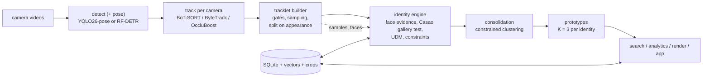

# Technical report: multi-camera person Re-ID and face association (v2)

This is the technical description of the current system (package `reid`, version 0.2.0, branch `v2`).
It covers what the code does, which parameters control it, which papers it follows, what was measured,
and what is still missing. Every measured number comes from the project's internal changes log (cited below as
"changes_log"). Defaults quoted below come from
[`configs/default.yaml`](../configs/default.yaml) and [`configs/presets/`](../configs/presets).

## 1. System overview

Input: one or more camera videos (files). Output: a set of persistent identities (`gid`), each with the
tracklets, crops, faces and journeys that belong to it, plus search, analytics, rendered videos and a web app.
Everything is stored locally in one folder (an "environment"). There is no cloud service.



Design points:

- Unit of identity is the **tracklet** (one person, one camera, one continuous track), not the frame. A tracklet
  gets one decision from several good samples, not one decision per frame.
- The identity engine follows Casao et al. (self-adaptive gallery, softmax ratio test, Unknown Data Manager),
  extended with face evidence and multi-camera constraints.
- Every tracked box of every frame is stored, so any video can be re-rendered and any person followed
  afterwards without re-running the models.
- Cameras are processed one after the other in one run, into one shared identity space.

## 2. Data model

One environment is one folder (`paths.data_dir`). Layout:

| Path | Content |
|---|---|
| `reid.db` | SQLite database (schema version 2, `src/reid/storage/db.py`) |
| `vectors/` | Vector collections as `<name>.npy` (N x D float32, L2-normalised) and `<name>.ids.npy` (N x 2 int64: key, label) |
| `crops/<id//1000>/t<id>.jpg` | Best body crop of each tracklet |
| `faces/<id//1000>/t<id>.jpg` | Best face crop of each tracklet |
| `renders/` | Rendered videos, GIFs, heatmaps (cache, can be regenerated) |
| `eval/<name>.json` | Evaluation results shown in the Metrics tab |
| `cache/` | Per-run statistics (`run_<id>.json`: stage timings, GPU memory, device plan) |
| `uploads/` | Videos added through the app (the database keeps a relative path) |
| `env.json`, `.reid_data` | Environment metadata and the marker that allows a guarded reset |

Source videos are referenced by path and never copied, except uploads from the app and `--with-videos` exports.

### SQLite tables

| Table | Purpose |
|---|---|
| `runs` | One row per `reid process` call: time, full config as JSON, status |
| `cameras` | Id, video path, real fps, processed size, `start_ts`, `is_face_cam`, optional homography (image to floor, stored in processed pixels) and background |
| `tracklets` | One row per tracklet: camera, frame and time range, point and sample counts, mean quality, `gid`, `assign_score`, `assign_source` (`body`, `face`, `consolidate`, `manual`), best crop and face paths |
| `track_points` | Every tracked box (frame, ts, x1..y2, conf, `sampled`). `WITHOUT ROWID`, key `(tracklet_id, frame)` |
| `identities` | `gid`, label, first/last timestamp, number of tracklets, `has_face` |
| `tracklet_gid_history` | Every gid change of a tracklet with old/new source and reason, so consolidation is reversible |
| `samples` | Body samples of tracklets (id = key in the `body_samples` collection, quality, `in_gallery`) |
| `identity_cannot_links` | Persistent cannot-links, for example after a manual split |

Time is `camera.start_ts + frame_index / fps`, with fps read from the video (config can override it).

### Vector collections

| Collection | Content | Rebuilt |
|---|---|---|
| `body_samples` | Up to 16 body embeddings per tracklet, label = gid | labels follow gid changes |
| `body_tracklet` | One quality-weighted mean per tracklet | |
| `face_tracklet` | One face descriptor per tracklet that has faces | |
| `body_proto` | K = 3 prototypes per identity (search index) | per affected gid |

Dimensions: body 1280 (CLIP-ReID) or 512 (OSNet); face 512 (ArcFace). Search reads the models an
environment was processed with, so the dimensions always match. The backend is NumPy brute force
(exact cosine); `faiss-cpu` is optional (`pip install "reid[faiss]"`).

## 3. Stages

### 3.1 Detection and pose

Models: YOLO26-pose (Ultralytics) or RF-DETR S/M/L, plus a separate YOLO26-pose on padded crops when the
detector has no keypoints. YOLO26 is end-to-end (NMS-free). Person class only (`detection.classes: [0]`).

| Parameter | Default |
|---|---|
| `detection.model` | `yolo26m-pose.pt` (balanced) |
| `detection.conf` | 0.25 |
| `detection.imgsz` | 640 (RF-DETR uses its own resolution) |
| `quality.pose_model` | `null` (single-model mode: keypoints come from the detector box itself) |
| `runtime.max_side` | 1920: larger frames are downscaled right after decoding; all later stages use that size |
| `runtime.frame_stride` | 1 (the evaluation runs used 2) |

In single-model mode each box has its own keypoints (v1 took the first pose found in the crop).

### 3.2 Tracking

One tracker per camera (`tracking/tracker.py`, boxmot 26.0.0). Paper: BoT-SORT, arXiv:2206.14651.

| Parameter | Default |
|---|---|
| `tracking.tracker` | `botsort` (`bytetrack` in lite, `occluboost` in max) |
| `track_high_thresh` / `track_low_thresh` / `new_track_thresh` | 0.5 / 0.1 / 0.6 |
| `track_buffer` | 30 frames |
| `match_thresh` | 0.8 |
| `use_cmc` | true (camera-motion compensation) |
| `appearance` | false; true in `accurate` and `max` |
| `appearance_thresh` | 0.25 (BoT-SORT paper value) |

By default the tracker is motion-only. With `appearance: true` the pipeline embeds every detection with the body
model and gives the embeddings to the tracker (BoT-SORT and OccluBoost only; ByteTrack ignores it with a
warning). This avoids swapping two people who cross, costs about 40% of the speed on a GTX 1050, and the embeddings
are reused as tracklet samples, so nothing is embedded twice.

### 3.3 Tracklet builder

`tracking/tracklets.py`. Turns tracker output into finalized `Tracklet` objects.

1. Every tracked box becomes a `TrackPoint` (stored for all frames).
2. A box becomes a **sample candidate** only if it passes cheap gates, in order. The gates are cheap on purpose,
   because the embedding model runs only on accepted samples.

   | Gate | Parameter | Default |
   |---|---|---|
   | detection confidence | `quality.min_det_conf` | 0.75 (0.5 in lite) |
   | box height | `quality.min_box_h` | 96 px |
   | not cut by the frame edge | `edge_margin_px`, `reject_truncated` | 2 px, true |
   | keypoint visibility | `kp_conf`, `min_visible_ratio` | 0.3, 0.5 of 17 keypoints |
   | at most one sample per track every | `sample_every` | 5 processed frames |
   | sample quality (visibility x confidence) | `min_quality` | 0.35 |

3. Accepted crops are embedded in batches (`runtime.batch_size` 16) across tracks and frames.
4. The best `max_samples_per_tracklet` (16) samples by quality are kept, plus the best crop image.
5. On face cameras, face detection runs on accepted samples only (see 3.5).
6. A tracklet is **finalized** when its track has been missing for `track_lost_s` (2.0 s) and when the video ends.
   Tracks shorter than `min_points` (5) are dropped. Tracklets with fewer than `min_samples` (2) samples keep
   their points but get no identity (`gid` NULL); they are drawn grey.
7. **Split on appearance.** The tracker can swap two people who cross. The builder keeps the chronological
   embedded samples of each open track (bounded by `max_history`, 400) and, at finalization, finds the best change
   point `k` that minimises `cos(mean(e[:k]), mean(e[k:]))` with at least `split_min_samples` (3) per side. It
   splits when the similarity is below `split_min_sim` (0.7), recursively. The cut is placed where the track had
   the highest overlap with other tracks. Calibration on scene 075 with CLIP-ReID: halves of one person >= 0.88
   (median 0.96); different people <= 0.58 (median 0.17).

Finalization is incremental: a tracklet is handed to the identity engine as soon as it closes, while the
video is still being read. Nothing waits for the end of the file.

### 3.4 Body embedding

| Model | Dim | Used in |
|---|---|---|
| CLIP-ReID ViT-B/16, MSMT17 weights (AAAI 2023) | 1280 (BN-neck features, 768 + 512) | balanced, accurate, max |
| OSNet x1.0, MSMT17 (boxmot) | 512 | lite |

Preprocessing for CLIP-ReID matches the official config: stretch to 256 x 128, mean/std 0.5. OSNet uses
ImageNet statistics. fp16 is used on CUDA devices with compute capability >= 7 and never on CPU or Pascal.

### 3.5 Face

InsightFace packs: SCRFD detector plus ArcFace recognition (CVPR 2019), 512-D. Only cameras marked
`is_face_cam` run it, and only on accepted samples.

| Parameter | Default |
|---|---|
| `face.model` | `buffalo_l` (`buffalo_sc` in lite, `antelopev2` in max) |
| `det_size` | 640 (480 in lite; capped to 480 on CPU) |
| `det_conf` | 0.7 |
| `head_region` | face centre in the top 0.4 of the body box |
| `max_faces` | 5 best faces per tracklet |
| `min_face_px` / `full_size_px` | 32 / 112 |

Face quality is detection score x size factor x frontalness (from landmarks). The best face in the head region is
kept (not the first). Face weights are research-only licensed and are downloaded at run time, never committed.

### 3.6 Identity engine

`identity/associate.py` (`IdentityEngine`), with `gallery.py`, `udm.py`, `constraints.py`. State is persisted
and reloaded, so runs accumulate across sessions. Interface used by the pipeline:
`on_tracklet(t)`, `end_camera(camera_id)`, `end_run(run_id)`.

**Per finished tracklet** (`on_tracklet`):

1. **Descriptors.** Quality-weighted mean of the sample embeddings (body) and of the best faces (face).
2. **Face first, with accumulated evidence.** Query `face_tracklet`, aggregate per gid. Assign when the best
   cosine >= `face_match` (0.55), the lead over the next different-looking gid >= `face_margin` (0.05) and at least
   `face_min_obs` (2) of the tracklet's faces support it. Source becomes `face`.
3. **Body test (Casao et al. 2023).** Softmax over cosine similarity to the quality-weighted gallery
   centroids with inverse temperature `softmax_temp` (10, i.e. v = 0.1). Accept if `p1/p2 >= tau` (2.0) and
   `cos >= min_cos` (0.78, a floor from v1 that is not in the paper) and at least `sample_vote` (0.5) of the
   samples agree on the same gid. This is the project's addition; Casao decides per frame.
4. **Constraints.** Gids with a cannot-link to this tracklet are excluded before both tests:
   - the same camera and an overlap in time greater than `overlap_tolerance_s` (0): one person is not in two
     places of the same view. Time rules compare only tracklets of the same run;
   - a face conflict: both tracklets have faces and their cosine is below `face_conflict` (0.3);
   - topology (`use_topology`, when the camera set defines `min_transit_s`): a transit between cameras that is
     shorter than possible.
5. **Verify before update.** Samples enter the identity's gallery only after a confident assignment, one by one
   through Casao's diversity gate (insert only if `D_i(x) >= D(C_i)`, `diversity_ref: min`). Over budget
   (`gallery_budget` 50), the sample with the largest `gamma*H/log N - (1-gamma)*D_i` is dropped
   (`gallery_gamma` 0.6). A tracklet assigned by face whose body confidently contradicts the face gid is not
   inserted; it records a must-link for consolidation instead of an immediate merge.
6. **Unknown Data Manager (UDM).** Unmatched tracklets go to a pool. At `end_camera` and every `udm_every` (20)
   pooled tracklets, the pooled descriptors are clustered with DBSCAN (cosine, `udm_eps` 0.15, honouring
   cannot-links). A cluster with at least `udm_min_samples` (20) samples is compared with its `udm_k` (3) nearest
   centroids: if the distance exceeds `udm_new_dist` (0.1) it mints a new gid, otherwise it merges into the
   nearest one.
7. **Bootstrap** (Casao's initialisation). While there are fewer than `bootstrap_q` (20) identities, an unmatched
   tracklet with at least `bootstrap_min_samples` (8) samples mints directly, or joins an existing gid when the
   cosine is above `bootstrap_join_cos` (0.9).

**End of camera / end of run:**

- `end_camera` runs the UDM on what is pooled.
- `end_run` flushes the pool (every remaining tracklet with enough samples becomes its own gid, so nobody
  disappears), runs consolidation, and rebuilds the prototypes of the affected gids.

### 3.7 Consolidation

`identity/consolidate.py`. Constrained average-linkage agglomerative clustering over gid centroids, stopped at
`merge_threshold` 0.35 (1 - cos, i.e. cosine 0.65; 0.25 left one man split on the real warehouse showcase and 0.35 gave identical results on AI City). Face must-links are applied first. Cannot-links are never violated, also
transitively. The merged identity keeps the oldest gid. Tracklets are relabelled with `source='consolidate'` and
the change is written to `tracklet_gid_history`. Galleries of merged identities are united and pruned to budget.
By default it also clusters with identities already in the environment (`include_existing`). Manual operations
(merge, split a tracklet, rename, re-cluster) use the same machinery; a manual split writes a persistent
cannot-link so consolidation does not undo it.

### 3.8 Prototypes and search

`identity/prototypes.py`, `search.py`.

- **Prototypes.** `proto_k` = 3 per identity. Default method `alpha_fps`: farthest-point sampling seeded by the best
  quality sample, with quality and distance min-max normalised per step and weighted by `proto_alpha` 0.5. Option
  `gcp` implements Al Muzaddid and Beksi (arXiv:2510.17043, Algorithm 1: farthest points interpolated toward the
  nearest prototype, `x <- x + gcp_alpha (p - x)`, alpha 0.5 because the paper does not state it).
  Deviations from the paper: exactly K prototypes are returned, cosine distance, re-normalised.
- **Body search.** Embed the query, query `body_proto` (`search.top_k` 10), keep the best score per gid, and
  apply the softmax ambiguity check (`search.tau` 1.5, `softmax_temp` 10, `body_min_cos` 0.75). Status:
  `MATCH`, `AMBIGUOUS` or `UNKNOWN`.
- **Face search.** Detect the largest face (or embed a pre-cropped face with gray padding `face_pad` 1.0), query
  `face_tracklet` (`face_top_k` 5), aggregate per gid, require `face_min_cos` 0.55 and `face_margin` 0.05.
- **Both.** Face has priority; body is the fallback.

### 3.9 Analytics, rendering, app

- `analytics.py`: pure functions over the database: `journey`, `transitions` (camera to camera matrix),
  `dwell_stats`, `occupancy`, `run_summary` (people count, identified %, face-confirmed %, tracklets per person).
- `viz/`: `render_camera` (re-reads the video and draws every stored box, H.264 through an ffmpeg pipe), `render_mosaic`
  (all cameras on the shared timeline), `follow_person` (cuts between cameras along one person's journey),
  presence timeline, foot-point heatmaps from all track points (per camera, per person).
- `app/` (Gradio 6.32.0): tabs Overview, Process, Explore, Search, Cameras, Metrics, Admin. Tab files contain
  layout and wiring only. Handlers call `reid.pipeline`, `reid.search`, `reid.analytics`, `reid.viz`. Long jobs run in
  worker threads with a concurrency limit of 1. Renders are cached under `renders/app/`, keyed by parameters and a
  fingerprint of the tracklet-to-identity assignment. An environment bar switches between environments.
  `--share` requires a login (generated if `--auth` is not given); the URL fetcher in Search accepts only public
  http(s) hosts, refuses redirects and caps downloads at 8 MB.

## 4. Presets

Selected with `--preset`. Precedence of configuration: built-in defaults < preset < `-c` file < `--set KEY=VALUE`.

| Preset | Detector (+ pose) | Tracker | Body ReID | Face | Target |
|---|---|---|---|---|---|
| `lite` | YOLO26n-pose (single model) | ByteTrack | OSNet x1.0 (512-D) | buffalo_sc | small GPU / CPU |
| `balanced` (default) | YOLO26m-pose (single model) | BoT-SORT, motion-only | CLIP-ReID (1280-D) | buffalo_l | free Colab T4 |
| `accurate` | RF-DETR-M + YOLO26s-pose on crops (320) | BoT-SORT with appearance | CLIP-ReID | buffalo_l | on request (6 GB+ GPU) |
| `max` | RF-DETR-L (704) + YOLO26m-pose on crops (384) | OccluBoost with appearance | CLIP-ReID | antelopev2 | quality first |

`max` does not use PersonViT-B yet: the preset file says so, and the weights are not wired in (see
[future_work.md](future_work.md)).

### Measured GPU memory and speed

GPU memory is the whole-process peak read from NVML (includes the CUDA context, the PyTorch cache and ONNX Runtime
when it runs on GPU). The local numbers were taken on a GTX 1050 (3 GB) on a 1-minute AI City slice, with the face
models on CPU, so they are not counted.

| Preset | GPU memory (GTX 1050) | Speed | Source |
|---|---|---|---|
| `lite` | 0.26 GB | 49.9 fps (120 s, 4 cameras, stride 2); 20.8 fps in an early smoke test with other GPU load | changes_log P6, P2 |
| `balanced` | 0.87 GB local; 1.02 GB on T4 (face on GPU) | 16.9 fps on GTX 1050; **34 fps on Colab T4** | changes_log P7 |
| `balanced` + appearance tracking | not measured | 9.6 fps on GTX 1050 | changes_log P7 |
| `accurate` | 0.82 GB | not measured end to end | local_app.md |
| `max` | 1.14 GB (the planner estimated 1.24 GB) | 4.0 fps on GTX 1050 (300 frames per camera, 2 cameras) | changes_log |

fps counts processed frames (with `frame_stride` 2, every second source frame). `accurate` and `max` were
not evaluated for accuracy. Early smoke figures were taken while a game used part of the GPU, so they are
pessimistic.

## 5. Device planner and `--preset auto`

`models/planner.py` places each model from the machine and the config, as a pure function of `Config` and a
`Hardware` description (so it is tested with fake machines).

- Order: detector, body ReID, pose, face. Each model goes to the GPU if its measured cost fits in
  `free VRAM x 0.88 - 100 MB (CUDA context)`; otherwise to CPU, and smaller models still try the GPU.
- Costs come from a measured table (`planner.COSTS`, measured one model per fresh process with
  `python -m reid.models.vram_probe`): for example `yolo26m-pose` 490 MB, CLIP-ReID 385 MB + 9 MB per crop,
  OSNet 33 MB + 13 MB per crop. Face packs are estimates.
- Face models run on the GPU only if compute capability >= 7 and an onnxruntime CUDA provider exists. onnxruntime-gpu
  1.32 has no Pascal kernels, so on a GTX 10xx the face models run on CPU.
- Models placed on CPU get smaller inputs when `runtime.cpu_downsize` is on (detector 640, pose 320, face 480);
  this is logged.
- Out-of-memory at run time is handled in `models/placement.py`: free the cache, halve the batch once, retry,
  then move that model to CPU. Events are recorded in `device_plan.events`.
- `runtime.device_plan` (`auto|gpu|cpu`), `runtime.vram_budget_gb` (simulate a smaller GPU) and explicit
  `detect_device` / `embed_device` values override the planner.

`--preset auto` (default for `reid process` and `reid app`; the other commands default to `balanced`): no CUDA or
less than 2 GB free VRAM gives `lite`; anything else gives `balanced` (the preset with the strongest evidence; on the real warehouse showcase `accurate` merged two similarly dressed men). `max` is
never chosen automatically. `reid info` prints the hardware, the preset auto would pick and the device plan.

Measured on the GTX 1050 (600 frames): auto chose `balanced`, detector and body on GPU, face on CPU, 10.8 fps,
0.87 GB. With `vram_budget_gb=0.4` everything ran on CPU at 1.6 fps; with 0.8 the detector was on GPU, body and
face on CPU, 8.7 fps. With no GPU (`CUDA_VISIBLE_DEVICES=`), auto chose `lite` on CPU at 9.3 fps.

## 6. Environments, portability, notebooks

- **Environment.** A subfolder of a workspace that holds `reid.db` or `env.json`. `reid app --workspace DIR --env NAME`.
  Different footage sets do not mix.
- **Moving data.** `reid env list|export|import|relink`. `export` zips an environment with a consistent copy of the
  database (SQLite online backup). `relink` points cameras at local copies of the videos by file name.
- **Sync.** `reid sync push|pull --workspace W --remote TARGET`, where TARGET is a folder (mounted Drive, USB) or an
  rclone path `name:path` (used only if `rclone` is already installed). Per environment it compares a fingerprint
  (consistent database snapshot plus vector file sizes) and the last synced state. It copies only when one side
  changed, refuses when both changed (exit code 3), and with `--force` first moves the destination aside as
  `<env>.bak-<timestamp>`. Details in [local_app.md](local_app.md).
- **Colab launcher** (`notebooks/colab_demo.ipynb`): installs the package, mounts Drive, starts `reid app --share
  --auth ...` on `MyDrive/reid_data/environments`. It processes nothing itself; footage is added in the Process tab.
- **Walkthrough** (`notebooks/colab_walkthrough.ipynb`): reproduces the AI City benchmark end to end.
- **Kaggle benchmark** (`notebooks/kaggle_aicity_benchmark.ipynb`, generated by `scripts/build_kaggle_notebook.py`):
  the official AI City 2024 protocol on 4 full scenes with 2 T4 GPUs, see section 7.
- The Colab notebooks are generated by `scripts/build_colab_notebook.py` and contain only `reid` commands (through
  `reid.notebook.sh`), no pipeline logic. `scripts/test_notebook.py` runs the launcher locally, skipping cells tagged `colab-only`.
  Executed copies (`*_finished.ipynb`) hold the app password and are git-ignored.

## 7. Evaluation

### Protocol (`reid evaluate`, extra `[eval]`)

Dataset: **AI City Challenge 2024, Track 1** (NVIDIA, synthetic retail scenes, CC-BY-4.0). Scene 075: 4
overlapping cameras (0700, 0701, 0708, 0711), first 2 minutes, 1280 x 720, 30 fps, 10 people, 19,146 labelled boxes.
Fetch with `reid dataset fetch aicity24 --scene 075 --minutes 2`. Runs used `frame_stride` 2, IoU 0.5, and
ignored GT boxes shorter than 40 px.

| Metric | Meaning |
|---|---|
| Per-camera MOT (IDF1, MOTA, ID switches) | `motmetrics`, from stored track points and the gid hypothesis |
| Cross-camera IDF1 | gids mapped to GT ids over all cameras at once |
| Fragmentation and purity | GT people split over several gids, gids that mix people, tracklets that mix people |
| Held-out retrieval | 5 queries per person cropped from GT boxes at moments the system did not sample; Rank-1, Rank-5, mAP against `body_proto` |

The v1 figure of 85.35% was computed by re-querying the system's own saved crops against prototypes built from the
same crops, so it is not an accuracy and is not comparable with these numbers.

### Results (scene 075, 2 minutes, `balanced`)

| Run | Cross-camera IDF1 | Identities (10 people) | People split | Gids mixing people | Rank-1 | Speed |
|---|---|---|---|---|---|---|
| before the tracklet splitter (GTX 1050) | 82.4% | 11 | 2 | 1 | 92% | 16.7 fps |
| final, GTX 1050 | 89.4% | 10 | 0 | 0 | 96% | 16.9 fps |
| + appearance tracking, GTX 1050 | 90.4% | 10 | 0 | 0 | 96% | 9.6 fps |
| **final, Colab T4** | **88.3%** | **10** | **0** | **0** | **96%** | **34 fps**, 1.02 GB |

The `lite` preset on the same scene: IDF1 83.6%, 11 gids for 10 people (1 person split, none mixed), Rank-1 98%,
49.9 fps.

Reading the results:

- Identity is nearly perfect on this scene (purity 100%). The combined IDF1 is limited by recall (IDR about 81%
  for `balanced`), not by identity errors (IDP 97 to 98%). People 80 to 120 px tall are detected 39.7% of the time
  and 40 to 80 px 31.7% of the time with `balanced`.
- The tracker alone fragments tracks (44 tracklets for 10 people over 4 cameras). The identity layer repairs
  this: per-camera IDF1 improves by 20 to 30 points on the busy cameras.
- Rank-1 is near ceiling on this data and cannot separate the presets.

### Official protocol: HOTA on floor positions (`reid benchmark aicity24`)

The challenge scores a multi-camera system with **HOTA** computed on world coordinates, not on image boxes.
`reid benchmark aicity24 run` therefore processes **whole scenes** (all 16 cameras, about 800 s, 23,994 frames each,
original 1080p files, no trimming) and exports one prediction file per scene in the official format, one row per
identity per frame: `camera id frame x y w h xworld yworld`.

- **Floor position.** The dataset's `calibration_2025_format.json` gives, per camera, a homography from floor
  coordinates to full-resolution pixels. The fetcher stores its inverse (normalised so `H[2][2] = 1`) in the camera
  YAML in **source pixels**; the pipeline converts it to the processed resolution when `runtime.max_side` shrinks the
  frames (`H_proc = H_src @ diag(src_w/proc_w, src_h/proc_h, 1)`, `geometry.scale_homography`), so stored boxes and
  the stored homography always agree. The foot point is the bottom centre of the box.
- **Export** (`eval/aicity_export.py`). Only tracklets with a gid are used. Boxes are linearly interpolated between
  consecutive points of a tracklet when the gap is at most `2 * frame_stride` frames (so a stride of 2 does not
  halve the detections), never past a tracklet's ends. For each (gid, frame) the world position is the median over
  the cameras that see the identity; the row carries the camera with the largest box (the evaluator only uses
  `CameraId` to assign the row to a scene) and that box in source pixels.
- **Scoring** (`eval/aicity_official.py`). NVIDIA's `MTMC_Tracking_2024/eval` code is downloaded at run time (it is
  not part of this repository; its licence is NVIDIA's) and run as a subprocess. Per scene it keeps one row per
  (frame, id), matches predictions to ground truth by Euclidean distance on the floor (similarity reaches zero at
  2.0 m, coordinates rounded to 3 decimals) and averages HOTA over the alpha thresholds. The printed overall
  number is the mean over scenes; the evaluator prints nothing per scene, so `score` also runs it once per scene.
- **Setup.** Preset `balanced`, `runtime.max_side` 1280 (720p processing), `frame_stride` 2, scenes 075, 078, 082,
  086 (test split, public ground truth). The published 2024 leaderboard (overview paper, arXiv:2404.09432,
  Table 1, 17 submissions: 1. Yachiyo 71.94, 2. SJTU-Lenovo 67.22, 3. Nota 60.93, 4. Fraunhofer IOSB 60.88,
  5. UW-ETRI 57.14, 6. ARV 51.06; online entries received a 10% bonus, the table does not say whether it is
  included) is on all 30 test scenes, so it is context, not a like-for-like comparison.
- **Crash safety.** A long run must not lose finished work. A failure in any step of one scene (fetch, process, 2D
  evaluation, export, 720p encode, pack) is logged with its traceback in that scene's `logs/process.log`, recorded in
  `benchmark.json` as `status: failed` with `step` and `error`, its raw folder is deleted, and the next scene goes
  on. The command exits non-zero only if every scene failed. In the notebook a failing GPU process never stops the
  other one, no cell raises, scoring uses the scenes that succeeded, and the last cell prints an ok/failed summary.
  Runs are resumable per step (a finished run, `eval/*.json`, `aicity/predictions.txt`, the zip).
- **Packing.** Kaggle limits the number of output files, so after a scene succeeds its environment is zipped with
  `export_env` (database, vectors, crops, 720p videos, evaluation, logs) into `envs/<env>.zip` and the folder is
  deleted. The small files scoring needs stay in `results/<env>/`. `reid env import envs/<env>.zip --workspace W`
  restores a usable environment (tested round trip on a synthetic environment). `--no-pack` keeps the folders.
- **Remaining-time estimate.** Each `run` process logs `ETA | scene 075 camera 5/16 | 38% of this job | 31.2 fps
  (processed) | ~1 h 52 min left | ends ~14:40 UTC` every 60 s, at each camera end and at each step change, and writes
  `progress_<job>.json`. Work is source frames x cameras over the job's scenes (before a scene is fetched:
  23,994 frames x its camera count); speed is measured on the processing steps only; the remaining time adds the
  non-GPU steps (fetch, 2D evaluation, export) measured so far for the scenes still to run and one 720p encode for the
  tail. It is an extrapolation from what has been measured.
- **Smoke run.** `--smoke` runs the first scene with 2 cameras and the first 2 minutes through every step (including
  packing and official scoring) into `WORKSPACE/smoke`, then logs `PROJECTION | 4 scenes, 62 cameras, 2 GPUs: ~...`:
  the measured seconds per source camera-minute of each step scaled to the real scene list split over N GPUs, plus
  the model-load time per scene. It is an extrapolation from a 2-minute sample: costs that grow faster than linearly
  (identity consolidation, the 2D evaluation over 16 cameras) and CPU contention between the GPU jobs are not
  modelled. Its accuracy has not been checked against a full run yet.

### Official results (Kaggle, 2x T4, `balanced`, commit 68b36b0, 2026-11-25/26)

Two Kaggle sessions, one scene per T4: 075 + 082, then 078 + 086. Each scene is complete: 16 cameras, 23,994 frames
(13 min 20 s) per camera at 30 fps, 1920 x 1080, 30 to 36 people.

| Scene | Thresholds tuned on it | HOTA | DetA | AssA | LocA | Identities / GT people | IDF1 (2D) | Rank-1 |
|---|---|---|---|---|---|---|---|---|
| 075 | first 2 min of 4 cameras (3.75% of the scene) | 67.5 | 67.2 | 67.7 | 90.9 | 46 / 30 | 72.0% | 74.0% |
| 078 | no | 58.2 | 55.2 | 61.5 | 90.0 | 43 / 34 | 52.4% | 78.1% |
| 086 | no | 55.9 | 57.1 | 54.9 | 89.7 | 66 / 35 | 64.8% | 66.3% |
| 082 | no | 51.7 | 52.3 | 51.2 | 90.2 | 77 / 36 | 65.6% | 67.2% |
| **held-out mean (078, 082, 086)** | | **55.3** | 54.9 | 55.9 | 90.0 | | | |

- **Placement.** The held-out mean (55.3) falls between the 5th (57.14) and 6th (51.06) published entries. Those
  entries average all 30 test scenes, and the leading ones fine-tune their detector and ReID model on the AI City
  training split and associate across cameras with the calibration. Here no model is trained on AI City data and
  the calibration is only used to output floor positions.
- **Speed and memory.** 20.7 to 21.9 processed fps per T4 (`frame_stride` 2, Kaggle has 2 CPU cores), about 2.4 h of
  processing per scene; a whole session (fetch, process, 2D evaluation, export, 720p copies, packing, scoring) took
  4 h 37 min and 4 h 52 min. Whole-process GPU memory 1.05 GB (075/082 session) and 0.68 GB (078/086 session, same
  commit; the difference has not been investigated). The PyTorch peak of the detector and body model is 0.46 GB.
- **What limits the score.** Identity fragmentation (one person split into several gids: 66 and 77 gids for 35 and
  36 people) and missed people (about 18 predicted positions per frame for 26 people in scene 082). Only about 4%
  of the rows in scene 082 are simultaneous duplicates of another gid beyond the natural crowding of the ground
  truth, so the splits are mostly over time. Floor positions are accurate (LocA about 90 on every scene).
- **Not used.** Calibration-based association (floor-position continuity across overlapping cameras) and faces (the
  synthetic people have no usable faces). The 2D evaluation took about 2 h of each session and is not part of the
  official score.

## 8. Limitations

- **Small and distant people** are missed by the detector. This caps IDF1, not identity association.
- **One scene, synthetic people.** Thresholds (split 0.7, body match 0.78, consolidation 0.25) were calibrated on
  scene 075. Synthetic people have distinct appearances, so the result validates the plumbing and constraints,
  not absolute ReID thresholds on real crowds. One false split was seen (one person cut in two and re-joined).
- **Faces are not validated on real footage.** The AI City people have no usable faces. The face path is tested with
  synthetic evidence and sample images. `accurate` and `max` were not evaluated for accuracy.
- **Offline only.** Videos are processed as files, cameras one after the other. There is no live ingestion.
- **Appearance tracking** costs about 40% of the speed on a GTX 1050.
- **Pascal GPUs:** no fp16, and no GPU for the face models (onnxruntime-gpu 1.32 has no kernels for them).
- **Retrieval gallery is not disjoint** from the query tracklets (a query box is held out of the samples, but not the
  whole tracklet).
- **Privacy.** Faces and body descriptors are biometric data. Data stays local and shared app links need a login,
  but there is no consent, retention or blurring feature.
- **Licences.** The package is AGPL-3.0 because Ultralytics and boxmot are AGPL. InsightFace weights are
  research-only.

## 9. Reproducibility

Verified environment (Python 3.12, Linux): `torch 2.14.1+cu126`, `torchvision 0.29.1`, `ultralytics 8.4.218`,
`boxmot 26.0.0`, `rfdetr 1.12.1`, `insightface 2.1`, `onnxruntime-gpu 1.32.0`, `gradio 6.32.0`, NumPy 2.5.5.
The `models`, `app` and `eval` extras in `pyproject.toml` pin these. `torch` is not pinned in the extra because
Colab ships its own CUDA build. Pascal GPUs need the cu126 wheels (comment in `pyproject.toml`).

```bash
uv venv --python 3.12 && source .venv/bin/activate
uv pip install -e ".[models,app,eval,dev]"
pytest -q                 # CPU, synthetic data, no weights (default: -m "not models")
pytest -q -m models       # needs weights and a GPU or time on CPU
ruff check . && ruff format --check .
```

Fetch data and reproduce the benchmark:

```bash
reid dataset fetch aicity24 --scene 075 --minutes 2 --out data/datasets/aicity24_075
reid process --cameras configs/cameras/aicity24_075.yaml --preset balanced \
    --data-dir data/eval_bal --set runtime.frame_stride=2
reid evaluate --data-dir data/eval_bal --gt data/datasets/aicity24_075/gt.csv
```

The default test run needs no model weights. The `models` marker covers the tests that load real weights. CI
(`.github/workflows/ci.yml`) runs `ruff check`, `ruff format --check` and `pytest` on CPU with Python 3.11.
`configs/default.yaml` is generated from the pydantic models (`python -m reid.config_yaml`) and a test checks that
it is up to date.
